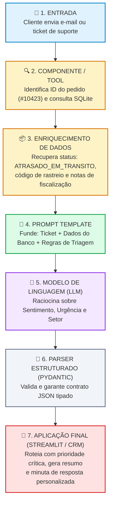

# Arquitetura e Funcionamento do Sistema de Triagem com Langflow & LangChain

Este documento detalha o funcionamento integral do sistema desenvolvido, desde a orquestração visual no **Langflow** e os componentes lógicos do **LangChain**, até a base de dados corporativa (**SQLite**) e a camada de apresentação final (**Streamlit**).

---

## 1. Visão Geral: As Três Camadas do Sistema

O sistema foi concebido em uma arquitetura desacoplada de três camadas:

| Camada | Tecnologia | Papel no Sistema |
| :--- | :--- | :--- |
| **1. Cockpit Visual** | **Langflow** | Permite projetar, inspecionar e prototipar visualmente o fluxo na forma de um grafo (nós e conexões), facilitando o compartilhamento e exportação da arquitetura em formato JSON. |
| **2. Motor de Inteligência** | **LangChain** | Framework em Python responsável pela execução do pipeline: orquestração de prompts, consumo de LLMs, acionamento de ferramentas (*Tools*) para consulta a bancos e validação estrita com Pydantic. |
| **3. Camada de Negócio e Aplicação** | **Aplicação (Streamlit / SQLite)** | Base de dados corporativa (`pedidos.db`) e painel web interativo onde os operadores de atendimento e analistas de suporte interagem com a solução. |

---

## 2. Diagrama de Fluxo e Ciclo de Vida do Chamado

O diagrama abaixo ilustra o percurso que uma mensagem percorre desde o recebimento até a entrega do parecer final de triagem:



---

## 3. Passo a Passo Técnico de Execução

Para entender o processamento de forma prática, considere o seguinte caso real:

> **Mensagem do Cliente:**  
> *"Estou FURIOSO! Comprei o notebook no pedido #10423 e não recebi até hoje! O prazo era dia 14/11. Se não resolverem hoje mesmo, vou abrir reclamação no Procon e acionar meu advogado!"*

### Etapa 1: Recepção e Captura (`ChatInput`)
- A mensagem é recebida via e-mail ou portal de chamados sem qualquer pré-processamento.
- O nó `ChatInput` disponibiliza o texto em formato bruto como string para o pipeline.

### Etapa 2: Extração de Entidades e Consulta ao Banco (`Tool / SQLite`)
- O componente Python ([langflow_component_custom.py](langflow_component_custom.py)) processa o texto e aplica expressões regulares (Regex) para identificar identificadores de pedido (`#10423` $\rightarrow$ `PED-10423`).
- Caso identifique um ID válido, realiza uma consulta direta e segura na tabela `pedidos` do arquivo [pedidos.db](pedidos.db):
  ```sql
  SELECT * FROM pedidos WHERE UPPER(id) = 'PED-10423';
  ```
- **Dados recuperados do banco:**
  - **Cliente:** Carlos Eduardo Silva
  - **Produto:** Notebook Gamer Ultra 16GB SSD 512GB
  - **Status Atual:** `ATRASADO_EM_TRANSITO`
  - **Transportadora:** LogExpress Cargas
  - **Código de Rastreio:** `BR987654321BR`
  - **Observação:** *"Mercadoria retida em fiscalização interestadual em 12/11. Nova previsão calculada para 22/11."*

### Etapa 3: Engenharia de Prompt e Contexto Enriquecido (`ChatPromptTemplate`)
O LangChain consolida todas as informações necessárias em um único prompt estruturado:
1. **Papel e Especialidade:** Define a persona de um especialista sênior em triagem de suporte.
2. **Diretrizes de Classificação:**
   - **Sentimento:** `POSITIVO` (elogios), `NEUTRO` (dúvidas) ou `NEGATIVO` (reclamações/indignação).
   - **Urgência:** `CRITICA` (ameaça jurídica/Procon, prejuízo iminente), `ALTA` (cobrança indevida, prazos estourados), `MEDIA` ou `BAIXA`.
   - **Setor:** `LOGISTICA`, `FINANCEIRO`, `SUPORTE_TECNICO` ou `COMERCIAL`.
3. **Injeção do Contexto Dinâmico:** Anexa o ticket original lado a lado com os dados oficiais do banco de dados.

### Etapa 4: Inferência e Cognição do LLM
- O modelo de linguagem (OpenAI GPT-4o-mini, Llama 3 via Groq ou motor heurístico resiliente) analisa a correlação entre o tom furioso do cliente e a falha de entrega comprovada pelo banco de dados.
- O modelo infere que a insatisfação é legítima, pois o prazo inicial era 14/11 e a carga encontra-se retida na fiscalização.

### Etapa 5: Validação Estruturada com Pydantic (`OutputParser`)
Para evitar respostas livres ou desestruturadas que quebrem sistemas automatizados, o LangChain valida a saída conforme o modelo [TriagemChamado](langchain_agent.py):
```json
{
  "sentimento": "NEGATIVO",
  "urgencia": "CRITICA",
  "setor_responsavel": "LOGISTICA",
  "id_pedido": "PED-10423",
  "resumo_problema": "Cliente reclama de atraso no pedido PED-10423. Mercadoria retida em fiscalização interestadual com previsão estendida.",
  "acao_recomendada": "Notificar transportadora LogExpress Cargas com prioridade máxima, monitorar liberação e enviar código BR987654321BR com cupom de cortesia.",
  "resposta_sugerida_cliente": "Olá Carlos Eduardo Silva, lamentamos profundamente o transtorno. Verificamos em nosso sistema que seu pedido PED-10423 sofreu uma retenção fiscal temporária na transportadora LogExpress Cargas..."
}
```

### Etapa 6: Apresentação e Entrega na Aplicação ([app_demo.py](app_demo.py))
A interface Streamlit consome a estrutura JSON gerada e exibe:
- **Badges de Alta Visibilidade:** Destaque visual em vermelho para Urgência `CRÍTICA` e Sentimento `NEGATIVO`.
- **Roteamento Inteligente:** O ticket é direcionado imediatamente para a fila do time de **Logística**, sem passar por atendentes generalistas.
- **Minuta Pronta para Envio:** O atendente humano tem à disposição uma resposta profissional e contextualizada com nome do cliente, produto e código de rastreio, precisando apenas de 1 clique para aprovar o despacho.

---

## 4. Relação Conceitual: LangChain vs. Langflow vs. Aplicação

```
┌────────────────────────────────────────────────────────┐
│                    LANGFLOW (GUI)                      │
│  Interface visual para desenhar, arrastar nós e fios   │
│  (Produz o arquivo: fluxo_langflow_triagem.json)       │
└───────────────────────────┬────────────────────────────┘
                            │ Compilação / Representação
                            ▼
┌────────────────────────────────────────────────────────┐
│                   LANGCHAIN (Código)                   │
│  Biblioteca em Python que implementa a lógica real:    │
│  ChatPromptTemplate | ChatOpenAI | @tool | Parser      │
└───────────────────────────┬────────────────────────────┘
                            │ Executa e alimenta
                            ▼
┌────────────────────────────────────────────────────────┐
│                   APLICAÇÃO FINAL                      │
│  Dashboard Streamlit / Base SQLite / APIs de Suporte   │
└────────────────────────────────────────────────────────┘
```

- **LangChain é a fundação em código:** Fornece as abstrações para conectar LLMs, prompts, ferramentas externas (SQL, APIs, Web) e cadeias declarativas (LCEL: `prompt | llm | parser`).
- **Langflow é o ambiente visual de prototipagem:** Funciona como um "Figma para IA", transformando cada elemento do LangChain em nós visuais configuráveis via browser.
- **A Aplicação é o produto entregue:** É onde o usuário ou operador colhe os benefícios do sistema de forma amigável e produtiva.

---

## 5. Vantagens e Boas Práticas Deste Design

1. **Eliminação de Alucinações em Dados Críticos:** O status do pedido, nome do cliente e código de rastreio não são inventados pelo modelo de linguagem; são resgatados via consulta SQL determinística.
2. **Resiliência e Execução Híbrida:** O sistema possui suporte transparente tanto para LLMs em nuvem (OpenAI/Groq) quanto para fallback determinístico local, viabilizando testes sem custos ou indisponibilidades de API.
3. **Facilidade de Manutenção e Evolução:** Para alterar critérios de triagem ou adicionar novos setores, basta atualizar as regras de negócio no template de prompt sem necessidade de refatorar a base de dados ou a interface web.

